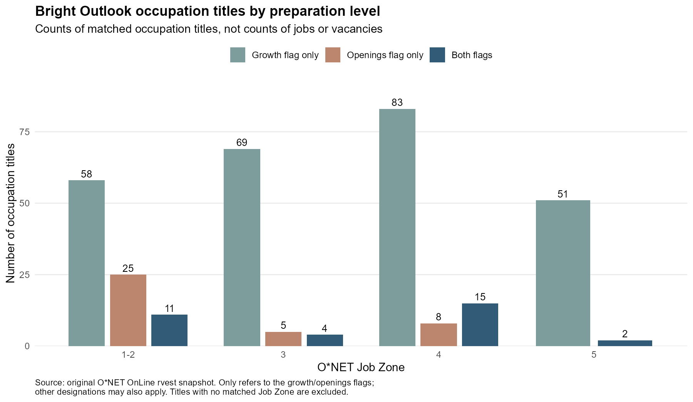

```{r}
#| include: false
source("code/analyze.R", local = TRUE)
result <- analyze_blog2()
n_all <- nrow(result$career)
n_matched <- nrow(result$analysis)
n_missing <- n_all - n_matched
n_both <- nrow(result$both)
share <- function(zone) {
  x <- result$both_summary
  sprintf("%.1f%%", sum(x$share_percent[x$`Job Zone` %in% zone]))
}
wage <- function(code) {
  x <- result$examples
  paste0("\\$", format(x$median_annual_wage[x$Code == code], big.mark = ",", trim = TRUE))
}
```

A fast-growing occupation is not automatically a good career choice. It may offer few openings, require years of preparation, or pay less than a job seeker needs. A more useful question is: **which occupations combine favorable prospects with preparation requirements and pay that fit the person considering them?** I use O*NET OnLine to turn broad career-outlook labels into a practical starting point for that comparison.

## What does a Job Zone actually mean?

O*NET's [Job Zones](https://www.onetonline.org/help/online/zones) combine **education, related experience, and training**. They are not degree categories or guarantees of entry. A bachelor's degree often corresponds to Zone 4, for example, but it does not automatically qualify someone for every occupation in that zone.

| Job Zone in this dataset | Typical preparation—not a universal credential requirement |
| --- | --- |
| 1–2 | High school/GED is common; some roles require less. Training can range from days to about a year. |
| 3 | Vocational training, an associate degree, or substantial related experience; apprenticeships may matter. |
| 4 | A four-year bachelor's degree is common, often alongside relevant experience or further training. |
| 5 | Graduate or professional education is common, together with extensive specialized preparation. |

A medical assistant in Zone 3 and a software developer in Zone 4 therefore represent different preparation routes—not simply “less college” and “more college.” Job Zone is a broad screening tool; occupation-specific requirements still need checking.

## Where do growth and openings overlap?

I originally scraped the public Job Zone and Bright Outlook tables with R's `rvest`, joining on occupation codes. The saved snapshot contains `r n_all` Bright Outlook titles; `r n_missing` lack a matched Job Zone, leaving `r n_matched` for the figure. Saved inputs make this comparison reproducible without repeatedly requesting the website. The supplied refresh function requests only public pages, sequentially with a pause, and does not bypass access restrictions.

The figure distinguishes a rapid-growth flag, a numerous-openings flag, and their overlap. Growth concerns expansion; openings can also arise when workers leave or change occupations. Other O*NET designations can coexist with these flags.

{#fig-outlook width=100%}

Of the `r n_both` matched titles carrying both flags, `r share("4")` are in Zone 4, while `r share("1-2")` are in Zones 1–2, `r share("3")` in Zone 3, and `r share("5")` in Zone 5. Favorable outlooks therefore span several preparation routes. These shares describe the composition of the selected titles—not the probability that an occupation within a zone has a favorable outlook, nor the share of available jobs.

## From categories to a usable shortlist

The following examples all carry both flags in the saved analysis snapshot. Their linked O*NET profiles supply national median annual wages for 2025, retrieved on October 26, 2026. The list snapshot and the wage-profile retrieval are separate vintages.

```{r}
#| echo: false
x <- result$examples
tab <- data.frame(
  Occupation = paste0("[", x$Occupation, "](", x$source_url, ")"),
  `Job Zone` = x$`Job Zone`,
  `Median annual wage (2025)` = paste0("$", format(x$median_annual_wage, big.mark = ",", trim = TRUE)),
  check.names = FALSE
)
knitr::kable(tab, escape = FALSE, align = c("l", "c", "r"))
```

Medical assistants offer a Zone 3 route with a median of `r wage("31-9092.00")`; someone considering it should check local training costs, duties, and certification expectations. For a reader with relevant degree-level preparation, accountants and auditors (`r wage("13-2011.00")`) and software developers (`r wage("15-1252.00")`) illustrate why the same Job Zone does not imply the same pay or skill requirements.

A practical approach is to screen first for a feasible preparation route, then compare named occupations against a salary target. Before paying for training, inspect local vacancies and employer requirements, verify any licensing rules, and compare training time and cost with likely entry pay. National medians describe existing workers across experience levels; they are not starting-salary promises.

Several limitations prevent treating this as a ranking of the “best” careers. The figure weights each occupation title equally, some titles share broader labor-market statistics, and unmatched titles are excluded. National projections do not establish local demand, hiring competition, work authorization eligibility, or working conditions. The four wage examples are illustrative, not representative of their zones, and do not estimate the return to education.

The takeaway is to use outlook flags to find possibilities, Job Zones to assess preparation, and occupation-specific pay and local requirements to decide what deserves further investigation. A favorable label begins the decision; it does not complete it.

## Sources

[O*NET Job Zone table](https://www.onetonline.org/find/zone?z=0), [Bright Outlook table](https://www.onetonline.org/find/bright?b=0), and [Job Zone definitions](https://www.onetonline.org/help/online/zones). Individual wage-profile links appear in the table; their underlying wage source is the Bureau of Labor Statistics. See `README.md` for snapshot provenance, data locations, and replication.
