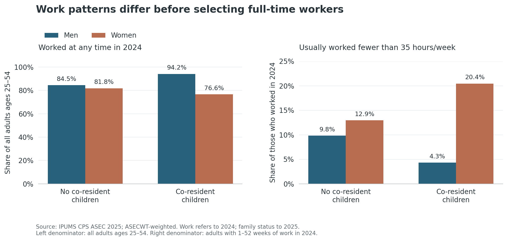
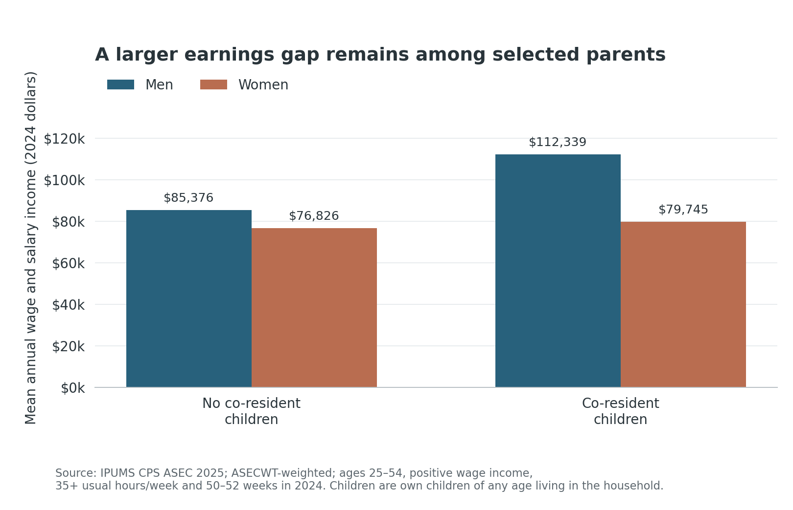
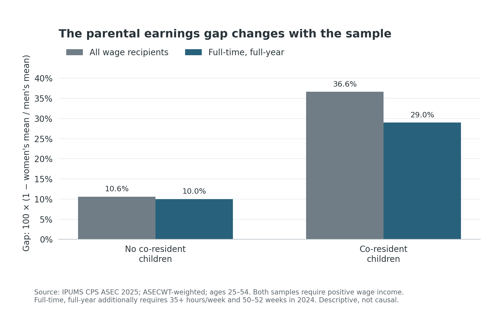

Does the gender earnings gap become larger when people have children? A comparison of full-time workers suggests that it does. But that comparison leaves out people who reduce their hours or stop working, potentially hiding an important part of the story. To understand the pattern, we need to ask both what workers earn and who makes it into the comparison.

I use the 2025 Annual Social and Economic Supplement (ASEC) of the CPS, accessed through [IPUMS CPS](https://cps.ipums.org/). The starting sample contains 55,003 adults ages 25–54. Work and income refer to 2024; age and family relationships are measured in the 2025 survey. Every reported population mean and proportion uses the ASEC person weight, `ASECWT`, so observations contribute according to the population they represent.

Here, “with children” means having one's own biological, adopted, or stepchildren of any age living in the household (`NCHILD > 0`). The other group can include parents whose children live elsewhere. This is therefore a comparison by household child presence, not by whether someone has ever become a parent.

## Who is missing from a full-time comparison?

Figure 1 begins with everyone in the age group, including people without wage income. The left panel shows the share who worked at least one week in 2024. The right panel asks, among those who worked, how many usually worked fewer than 35 hours per week. These different denominators distinguish not working from working part-time; neither measure is the official survey-week employment rate.

{#fig-work width=100%}

With co-resident children, 76.6% of women worked during the year, compared with 94.2% of men. Among those who worked, 20.4% of women usually worked part-time, versus 4.3% of men. Without co-resident children, the differences are smaller: annual work rates are 81.8% and 84.5%, respectively. The work measures include self-employed and unpaid family workers as well as employees.

A full-time-only comparison removes part-time workers from view, while requiring year-round work also excludes people who work for only part of the year. Similar hours within the remaining sample cannot establish that work time is unimportant.

## What do the workers who remain earn?

Now restrict the comparison to positive-wage recipients who usually worked at least 35 hours per week for 50–52 weeks. This leaves 34,996 people. Figure 2 shows their weighted mean annual pre-tax wage and salary income, in 2024 dollars. It measures annual wage income, not hourly pay or total earnings from every source.

{#fig-income width=100%}

Without co-resident children, men's mean income is \$85,376 and women's is \$76,826. With co-resident children, the means are \$112,339 and \$79,745. Higher male mean earnings across the two groups account for much of the larger parental gap. That is a descriptive comparison, not evidence that parenthood itself raises men's pay: age, occupation, education, and other characteristics also differ.

## How much does the sample matter?

Figure 3 compares that restricted sample with all positive-wage recipients, including part-time and part-year workers. The gap is 100 × (1 − women's weighted mean / men's weighted mean).

{#fig-gap width=100%}

With co-resident children, the gap is 29.0% among full-time, full-year workers but 36.6% among all wage recipients. Without co-resident children, it changes only from 10.0% to 10.6%. The larger change for parents is consistent with the work-pattern differences in Figure 1. It is not a causal decomposition, and neither earnings sample includes people with zero wage income.

The lesson is that sample selection changes the question being answered. Income among full-time workers describes one part of the parental gender gap; participation and working time reveal another. These cross-sectional data cannot identify a causal motherhood penalty, especially because family status is observed after the income year. Income imputation and topcoding also affect measurement, and no survey-design confidence intervals are estimated. The figures describe weighted patterns, not statistically established causal effects.

## Sources

Data: [IPUMS CPS](https://cps.ipums.org/), 2025 ASEC. Variable documentation: [NCHILD](https://cps.ipums.org/cps-action/variables/NCHILD), [WKSWORK1](https://cps.ipums.org/cps-action/variables/WKSWORK1), [UHRSWORKLY](https://cps.ipums.org/cps-action/variables/UHRSWORKLY), [INCWAGE](https://cps.ipums.org/cps-action/variables/INCWAGE), and [ASECWT](https://cps.ipums.org/cps-action/variables/ASECWT). Code, data access, and replication instructions are documented in `README.md`.
