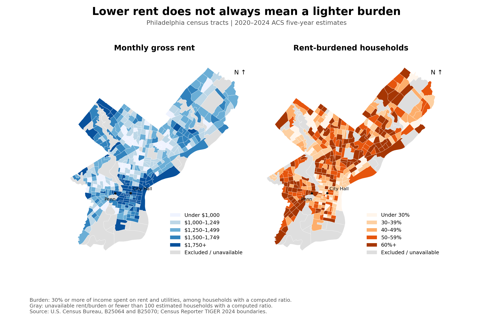
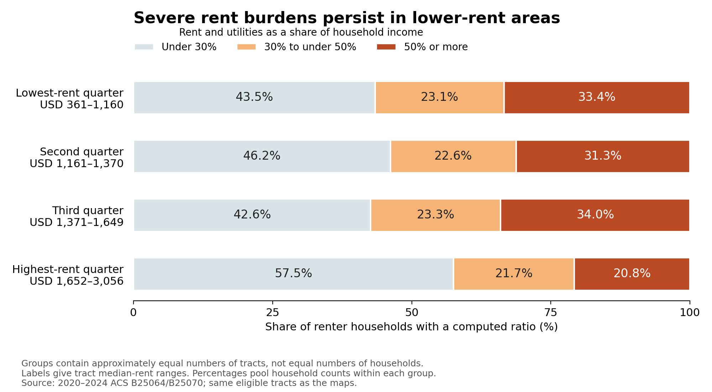
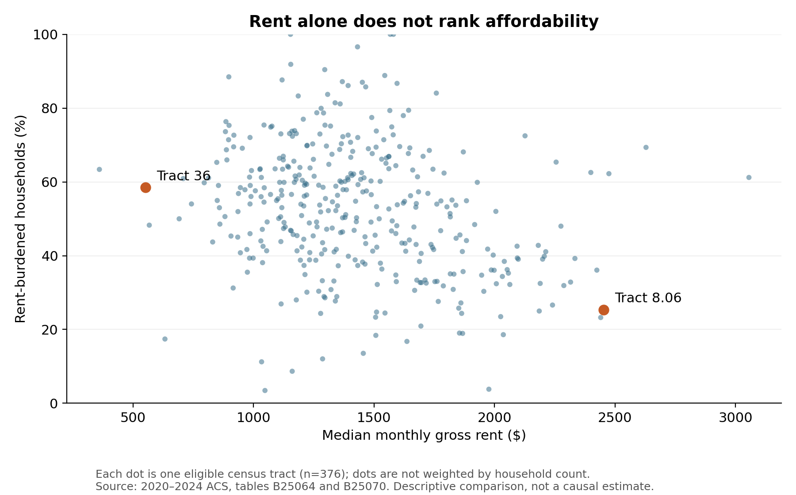

Searching for an apartment in Philadelphia, it is natural to start with the monthly rent. A cheaper neighborhood seems like the obvious place to find affordable housing. But affordable for whom? A lower rent can still absorb a large share of a household's income. Mapping both rent levels and renters' financial burdens reveals why a city's cheapest areas are not necessarily its least strained.

The maps tell different stories about the same city. Higher rents cluster around Center City, with additional expensive pockets elsewhere. Yet relatively light burdens appear in parts of that central area, while many tracts farther north and west show heavier burdens despite lower rents. The contrast matters because a rent map alone could direct attention away from places where residents struggle to pay. The same tract boundaries appear in both panels; darker blue means higher rent, whereas darker orange means a greater share of burdened renters.

I compare Philadelphia census tracts, small statistical areas that do not necessarily follow neighborhood boundaries, using the U.S. Census Bureau's [2020–2024 American Community Survey](https://data.census.gov/table/ACSDT5Y2024.B25070). These are five-year estimates, not a snapshot of 2024 or today's advertised rents. Monthly gross rent includes rent and utilities. I define a rent-burdened household as one spending at least 30% of its income on those costs: for example, $900 out of $3,000 a month. The burden rate is the share of renter households meeting that threshold among those whose rent-to-income ratio can be calculated. It is not a ratio of neighborhood medians.

To make the comparison concrete, I retain 376 tracts with available rent and burden measures and at least 100 estimated renter households with a calculable ratio. This removes 32 tracts; gray areas are excluded, not places with zero rent or no hardship. Splitting the retained tracts at their median rent of approximately $1,370, the lower-rent half has a burden rate of **55.1%**, compared with **49.2%** in the higher-rent half. These rates pool household counts within each group, so a tract with more renters contributes more than a small tract.

But crossing the 30% threshold is only part of the story. A household spending 31% of its income on housing faces a different budget constraint from one spending 60%. To distinguish those experiences, I divide the same tracts into four groups by median rent and separate renters into three burden categories. Each group contains approximately the same number of tracts; the percentages still pool household counts.

In the lowest-rent quarter, **33.4%** of renters with a computed ratio spend at least half their income on rent and utilities, compared with **20.8%** in the highest-rent quarter. For these households, half or less of their income remains for food, transportation, health care, and everything else. Yet the pattern is not a smooth decline: the third rent group has a slightly higher severe-burden estimate than the lowest-rent group. Lower rent does not guarantee relief, and higher rent does not uniformly imply less pressure.

Two tracts illustrate the mismatch. Tract 36, southwest of City Hall, has a median gross rent of $553, yet 58.5% of renters with a computed ratio are burdened. Tract 8.06, near Center City, has a median rent of $2,454 but a burden rate of 25.3%. These examples illustrate the pattern rather than establish a ranking: they are survey estimates, and households and housing units differ across locations.

The scatterplot reinforces that caution. Each dot represents a tract, and neighborhoods with similar median rents can have very different burdens. Income differences and the sorting of households across locations could help explain the pattern, but these maps cannot identify their individual contributions. They do not show that higher rents reduce hardship, or that moving a particular household would improve its situation. Housing size, subsidies, student populations, and household composition may also matter.

There are limits to the comparison. Excluding ratios that cannot be computed means the rates do not cover all renter households; households reporting no or negative income and units without cash rent can fall outside that denominator. Small-area estimates also have sampling uncertainty. The count cutoff is not a guarantee of statistical precision. I therefore emphasize broad patterns rather than small differences between neighboring tracts or rent groups.

Philadelphia's affordability problem is consequently easy to misread from prices alone. For residents comparing apartments, the relevant calculation is rent plus utilities relative to their own income. For identifying areas that may need support, burden rates add information that a low-rent label misses. Lower rents matter, but the map shows why they cannot, by themselves, tell us whether local renters can comfortably pay.

*Data: U.S. Census Bureau, ACS 2020–2024, tables B25064 and B25070, retrieved through [Census Reporter](https://censusreporter.org/); tract geometry from its TIGER 2024 endpoint. Analysis code, cached source data, and replication instructions accompany this article.*
