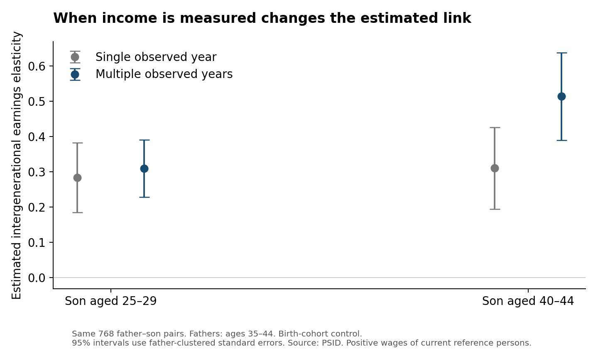

How much does a father's income tell us about his son's income? Before estimating that relationship, we must decide when to measure earnings. A salary early in a career can give a different picture from earnings in middle age. I use PSID data to ask how the estimated father–son link changes with the son's age and with the number of income observations used.

## Matching fathers and sons

I focus on biological fathers and sons to keep this parent–child matching demonstration manageable. Mothers and daughters are outside the scope of this example, so the results describe father–son wage persistence rather than parent–child relationships more broadly.

The PSID follows individuals across survey waves. I rename ER30001 and ER30002 as `family_id` and `person_no`; together they identify a person. ER32016 and ER32017 become `father_family_id` and `father_person_no`, identifying the biological father. ER32000 records sex. A family ID alone is insufficient because relatives can share it. I combine each person's two identifiers into a stable `person_id`.

I load the extract into Python, create a SQLite connection with `sqlite3.connect()`, and write a `people` table and an `income` table using `DataFrame.to_sql()`. The following query constructs the father–son pairs:

```sql
SELECT c.person_id AS child_id, p.person_id AS father_id
FROM people AS c
JOIN people AS p
  ON c.father_family_id = p.family_id
 AND c.father_person_no = p.person_no
WHERE c.sex = 1 AND p.sex = 1
  AND c.father_family_id > 0 AND c.father_person_no > 0;
```

`SELECT` chooses the output columns. `JOIN` connects two copies of the person table using both father identifiers. `WHERE` restricts the sample to men with recorded father identifiers. The full script checks that each son has at most one matched father.

## From annual wages to longer-run earnings

I use annual wages and salaries reported in survey waves from 1970 through 2023, generally referring to the previous calendar year. Earlier wage variables are brackets rather than dollar amounts, so I omit them. I convert wages into 2022 dollars using annual CPI, exclude nonpositive and special-coded amounts, and retain current household heads/reference persons. This prevents assigning a household head's wages to every family member. The Data Center links family wage variables to individual records using each wave's family interview number. That changing household identifier serves a different purpose from the stable identifiers used to match fathers and sons.

To use other years, retain the person and father identifiers, then request each chosen wave's wages, age, relationship, sequence number, and family interview number. For example, the 1970 wave uses V1191 for wages and ER30046 for age. `data/variable_map.csv` lists all wave-specific fields. Update the script's `years` and corresponding `income_vars` together, check codebook definitions and special codes, and provide CPI for the income years. The father–son join stays the same.

Fathers' wages are measured at ages 35–44. Sons' wages are measured at 25–29 and again at 40–44. I approximate income-year age as interview age minus one. To calculate fathers' averages in SQL:

```sql
SELECT person_id, AVG(earnings) AS father_mean,
       COUNT(*) AS father_n
FROM income
WHERE age BETWEEN 35 AND 44
GROUP BY person_id
HAVING COUNT(*) >= 3;
```

`GROUP BY` collects records for each person; `AVG` and `COUNT` aggregate them. `HAVING` keeps fathers with at least three valid observations. Analogous queries require at least two observations in each son's age window. These are averages of observed positive-wage years, not necessarily consecutive years: PSID became biennial after 1997.

The resulting balanced sample contains **768 father–son pairs** and **592 distinct fathers**. Every specification uses these same pairs. For a single-year measure, I select the observation nearest age 40 for fathers, 27 for younger sons, and 42 for middle-aged sons; an earlier wave breaks ties.

## What changes when earnings are measured differently?

I read the SQL results into pandas with `pd.read_sql_query()`, then regress log son wages on log father wages, an intercept, and a linear son birth-cohort control. The coefficient on log father wages is the intergenerational elasticity, or IGE. A coefficient of 0.4 means that 1% higher father wages are associated with approximately 0.4% higher son wages; this is an association, not a causal effect.



At ages 25–29, the IGE is **0.284** using single-year wages and **0.310** using averages. At ages 40–44, it is **0.310** and **0.514**, respectively. Averaging changes the middle-age estimate substantially. The intervals in the figure allow for siblings sharing a father.

Two measurement issues matter. Temporary wage fluctuations make one year a noisy proxy for long-run earnings; averaging can reduce that noise. Life-cycle bias is different: younger workers with different eventual earnings may have different wage-growth paths. The higher averaged estimate at ages 40–44 illustrates sensitivity to measurement age, consistent with Haider and Solon (2006). Averaging early-career wages alone does not solve this problem.

These unweighted estimates describe a selected sample of men with positive wages, head/reference-person status, and long follow-up. They are not a national mobility estimate. Lifetime earnings are unobserved, so the middle-age estimate is not a known truth, and the comparisons do not isolate every source of bias. The practical lesson is to match people carefully, average repeated observations, and check measurement age before interpreting an IGE.

## Sources and replication

- [PSID Data Center](https://simba.isr.umich.edu/data/data.aspx), public-use extract J366590; University of Michigan, Survey Research Center. Variable definitions are documented in the PSID codebook; the private download includes a copy.
- [Federal Reserve Bank of Minneapolis CPI historical table](https://www.minneapolisfed.org/about-us/monetary-policy/inflation-calculator/consumer-price-index-1800-), annual CPI series compiled from BLS historical data.
- Haider, S., and G. Solon (2006). [Life-Cycle Variation in the Association between Current and Lifetime Earnings](https://doi.org/10.1257/aer.96.4.1308). *American Economic Review*, 96(4), 1308–1320.

Full Python and SQL files, variable mappings, and instructions are in the accompanying repository files. PSID raw records are kept out of the public repository.
