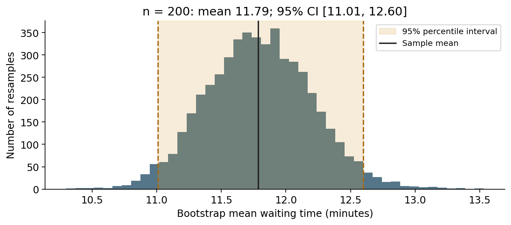
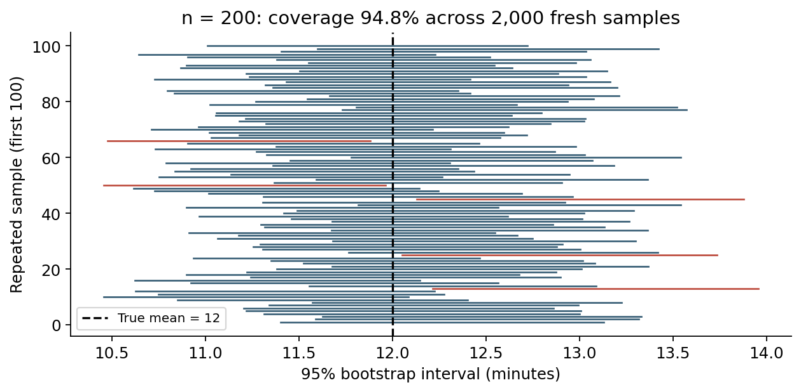
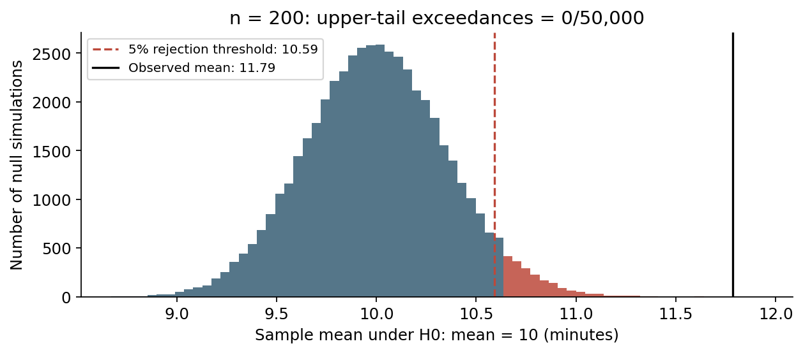

```{=html}
<style>.hero {margin:1.5rem 0} .hero img {width:100%;height:auto} .hero figcaption {font-size:.85rem;color:#666;margin-top:.4rem}</style>
<figure class="hero"><figcaption>A coffee-shop setting for exploring waiting times. AI-generated illustrative image.</figcaption></figure>
<p>A coffee shop claims that orders take ten minutes on average. A few long waits do not automatically disprove that claim: samples fluctuate. How can we distinguish a real difference from sampling noise? For a customer planning a short break, an extra two minutes matters. Simulation lets us check whether a sample can reveal that difference, because we know the truth behind the data.</p>
<p>I generate independent waiting times from a Gamma distribution with shape 4 and scale 3 minutes. Its population mean is shape times scale: 12 minutes. These are synthetic data, not observations from a real shop.</p>
<p>Why Gamma? Waiting times are positive, and a right-skewed distribution captures a useful pattern: most customers receive their orders relatively quickly, while a few wait much longer. Gamma also has a simple, known mean, making it convenient for checking inference. This is a teaching model, not evidence that actual coffee-shop waits follow this distribution.</p>
<h2>What can one sample tell us?</h2>
<p>The main experiment draws 200 customers. Their average wait is 11.79 minutes. To estimate its uncertainty, I draw 5,000 bootstrap samples from those same 200 observations, with replacement. Each resample contains 200 records; some original records appear several times and others disappear. I calculate a mean for every resample.</p>
<p>The first plot displays those bootstrap means. Their 2.5th and 97.5th percentiles give a 95% percentile bootstrap interval of [11.01, 12.60] minutes. The sample stands in for the population: resampling estimates how much its mean could vary. It adds no new independent information and does not assume a Gamma distribution.</p>
<figure><figcaption>Figure 1. Resampling one sample estimates uncertainty about its mean.</figcaption></figure>
<p>But does this interval-building method usually capture the truth? To check its coverage, I repeat the entire experiment 2,000 times. Each repetition draws a fresh sample from the population, performs 2,000 bootstrap resamples, and constructs a new interval. The resulting coverage is 94.8%: approximately 95% of intervals contain the fixed true mean of 12.</p>
<p>The second plot displays the first 100 intervals, including misses. The parameter stays fixed while intervals change. The confidence level describes the long-run performance of the procedure, not a 95% probability assigned to the fixed parameter after observing one interval. Percentile bootstrap coverage is approximate, especially with small, skewed samples; neither nominal confidence nor more bootstrap draws guarantees correct coverage.</p>
<figure><figcaption>Figure 2. Repeating the whole experiment reveals coverage; red intervals miss the true mean.</figcaption></figure>
<h2>What if the shop's claim were true?</h2>
<p>For a separate, one-sided test, I set H0: mean = 10 against H1: mean &gt; 10. The original sample comes from Gamma(4, 3), with mean twelve; ten is the shop's claim, not a consequence of skewness. To simulate a world consistent with the shop's claim, I keep shape 4 and set scale to 10/4 = 2.5: Gamma(4, 2.5) therefore has mean ten. Holding shape fixed preserves skewness and relative variability, but the standard deviation falls from six to five minutes. The test therefore assumes a specific Gamma family with known shape. Bootstrap resampling itself makes neither Gamma assumption.</p>
<p>I generate 50,000 samples of 200 customers under that null model and use their means as test statistics. The upper 5% forms the rejection region, starting at 10.59 minutes. The observed mean exceeds this threshold. The p-value estimates the probability, assuming H0 and this model, of a mean at least as large as observed. There are 0 exceedances; the finite-simulation correction gives (0 + 1)/(50,000 + 1) = 0.000020. Zero simulated exceedances would not mean zero true probability. At the 5% level, I reject H0: this sample provides evidence of an average wait above ten minutes under the specified model.</p>
<figure><figcaption>Figure 3. The observed mean lies beyond the upper 5% rejection threshold.</figcaption></figure>
<p>This one-sided 5% test and the two-sided 95% bootstrap interval are distinct procedures, not exact inverses.</p>
<p>In this simulated shop, the sample supports an average wait above ten minutes. The bootstrap interval shows its uncertainty, and repeated experiments show why a 95% method can still miss the truth. The conclusion concerns average waiting time, not every customer's wait. Real queues may have dependent observations and changing conditions, so ordinary independent resampling would need reconsideration.</p>
<p><small>All data are simulated. Code, generated data and replication instructions are provided in the accompanying repository.</small></p>
<h2>Explore the simulations</h2>
<iframe src="results/interactive.html" title="Interactive bootstrap and hypothesis testing demonstrations" style="width:100%;height:1650px;border:0" loading="lazy"></iframe>
```
