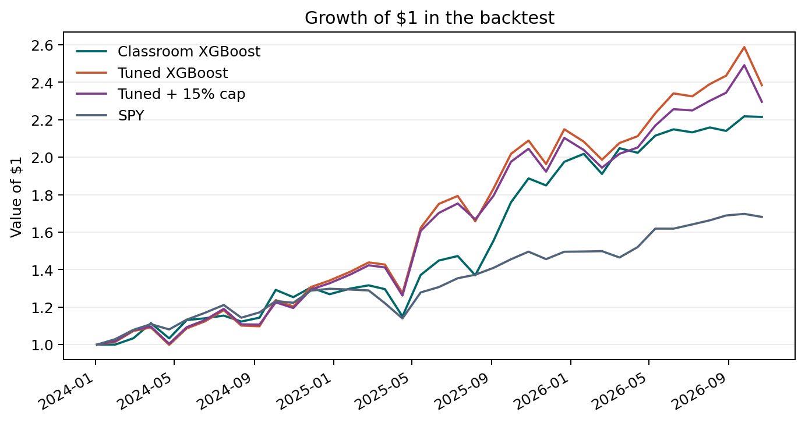

What can a stock-picking model tell me about a portfolio with more than 40 percent in one company? In a classroom trading game, I bought Nvidia to invest in AI chip demand. At the snapshot date, my 200 shares were worth $41,338, or 42.4 percent of the account. My indicator-based portfolio left Nvidia out and gave Visa a 40 percent target weight.

The classroom game tracked two $100,000 portfolios per team over two months. One used intuition and the other used quantitative indicators. Across 45 teams, the indicator-based portfolios finished $1,909 ahead on average and beat their paired portfolios in 30 teams. The paired 95 percent confidence interval ran from $380 behind to $4,197 ahead. These figures come from the Fall 2026 Stock Game Results workbook.

## Can a simpler model predict returns better?

For the historical backtest, I kept the instructor’s January 2024 cutoff for out-of-sample testing. The classroom XGBoost model forecasts roughly one month of returns by building decision trees that correct earlier errors. Its inputs include price trends, short-term reversal, historical volatility, daily returns relative to SPY, and trading volume. The classroom portfolio worksheet uses historical correlations, Sharpe ratio, and Jensen’s alpha. Those estimates can adjust slowly when conditions change. Daily price and volume data update faster, but even recent trading may offer little warning of a company-specific surprise.

I kept the stock list, predictors, and forecast horizon. I removed examples whose return windows crossed a data split and used the second half of 2023 to compare shallower trees. The selected model allows one split per tree, versus up to five along a path in the classroom model. Both models were fitted on eligible pre-2024 data. Root mean squared error (RMSE) gives larger forecast errors extra weight.

<!-- BEGIN FORECAST -->
| Model | Out-of-sample RMSE |
|---|---:|
| Historical mean | 8.89% |
| Classroom XGBoost | 9.38% |
| Tuned XGBoost | 8.98% |
<!-- END FORECAST -->

The shallower model improved on the classroom model. The historical mean had the lowest RMSE, but it assigns every stock the same forecast, so it offers no ranking. RMSE measures error across all stocks. Portfolio returns depend on what happens to the ten stocks each model ranks highest.

## Would the forecasts have made money?

At each rebalance, I weighted each model’s top ten stocks by their positive forecasts and used equal weights if none were positive. I corrected the classroom weight calculation and matched the strategies’ trading dates to SPY, an ETF that tracks the S&P 500. I used Yahoo Finance adjusted closing prices and assumed a cost of 10 basis points per dollar traded.

<!-- BEGIN PERFORMANCE -->
From Jan 03, 2024 to Oct 22, 2026, $1 earned **121.48%** with the classroom model, **138.42%** with the tuned model, and **68.13%** with SPY after the assumed trading costs.
<!-- END PERFORMANCE -->

Both strategies beat SPY in this window using a fixed stock list. The last complete holding period ended before Nvidia’s November announcement.

## What my Nvidia position exposed me to

My AI-chip thesis exposed me to export rules, supply constraints, and leadership news. At companies so closely identified with figures such as Jensen Huang, Elon Musk, or Jeff Bezos, a personal headline can matter if it changes expectations about governance or succession. Nvidia’s November 12 CEO transition made that risk tangible. [Nvidia’s announcement](https://investor.nvidia.com/news/press-release-details/2026/NVIDIA-Announces-CEO-Transition/default.aspx)

When I sized my Nvidia position, I gave too little weight to the uncertainty implied by its own options. VIX measures expected 30-day volatility for the S&P 500. Nvidia’s short-dated options give a more direct read on how much movement the market is pricing for the stock I held. Neither measure entered this backtest. An unexpected event can still move the stock far beyond what option prices previously implied. [Cboe on VIX](https://www.cboe.com/insights/posts/what-the-vix-and-vix-1-d-indices-attempt-to-measure-and-how-they-differ) · [Cboe on single-stock options](https://www.cboe.com/insights/posts/single-stock-volatility-bid-ahead-of-tech-earnings/)

If Nvidia alone fell 10 percent, my 42.4 percent position would cost the account 4.24 percent. A 15 percent position would cost it 1.50 percent. I tested that cap at each rebalance, holding any excess in cash.

<!-- BEGIN CAP -->
With the same forecasts, the cap reduced cumulative return from **138.42% to 129.56%** and barely changed maximum drawdown measured at holding-period ends, from **11.42% to 11.34%**. The cap limited exposure to a single-stock shock, while the portfolio could still fall as several holdings moved together.
<!-- END CAP -->

I still see why Nvidia appealed to me as a way to invest in AI demand. What I would change is the size of the position. Before I put 42 percent of a portfolio in one company again, I would ask how much I could afford to lose if the stock fell sharply on news I couldn’t see coming.
